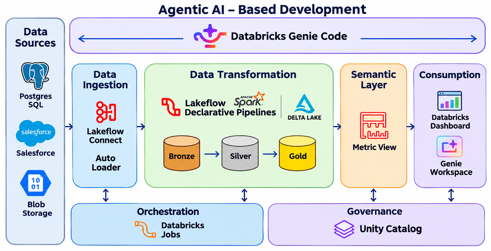
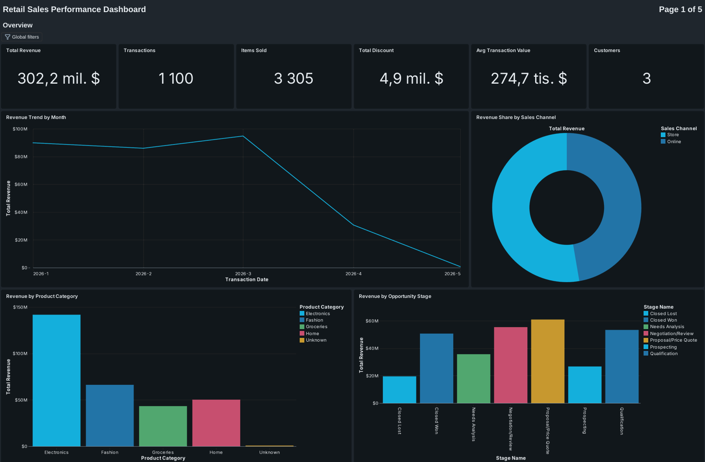
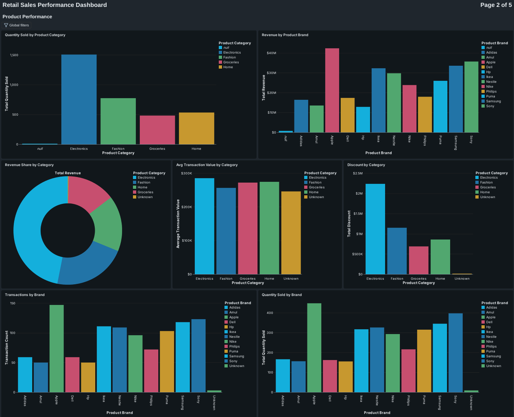
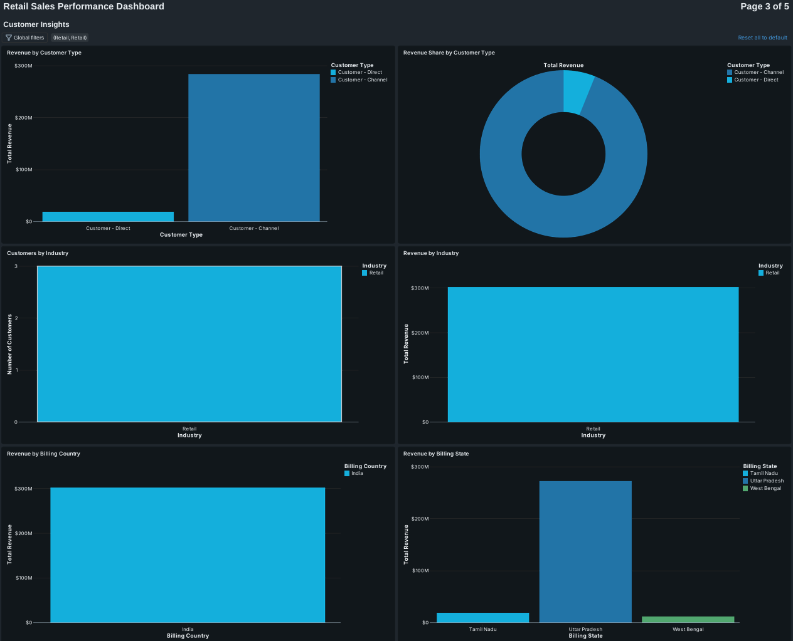
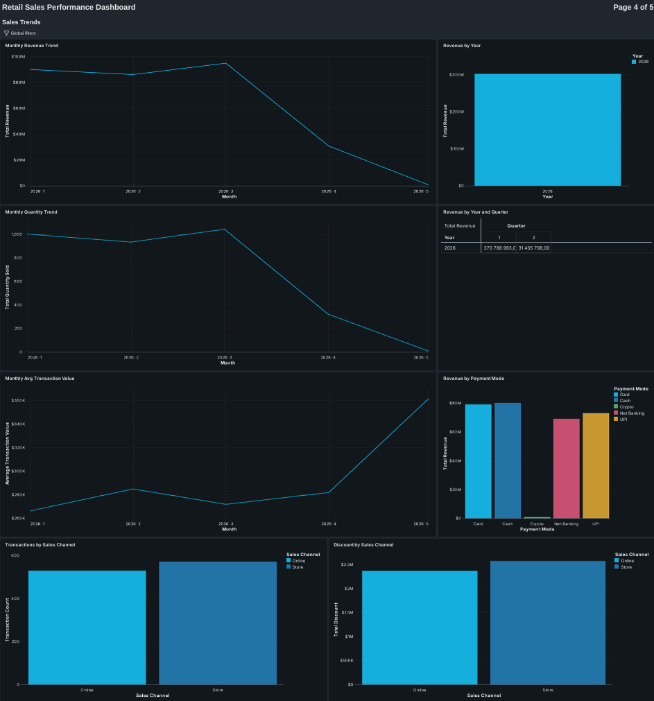
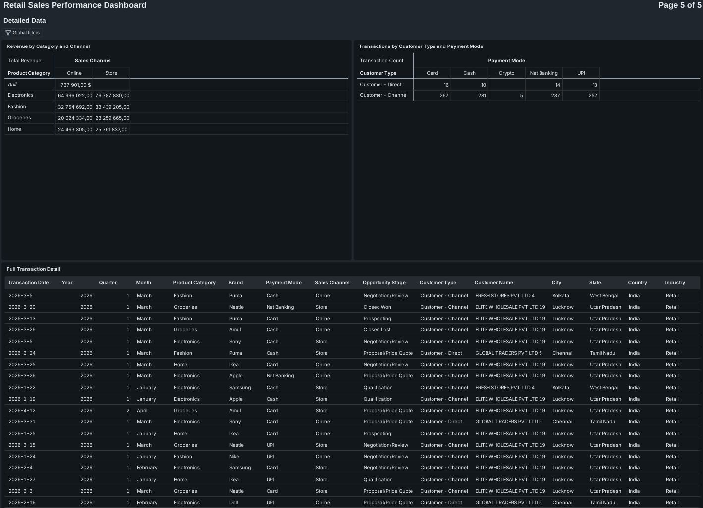

# End-to-End Retail Sales Data Pipeline on Databricks

## Architecture

  

## Background

Retail businesses generate large volumes of CRM, inventory, and transaction data. Data exists across multiple systems and file formats (PostgreSQL, Salesforce, CSV files in cloud storage), making unified analytics difficult. Business teams need quick insights into sales, customers, products, and inventory.

## Problem

Retail data is spread across disconnected sources, creating data silos. Traditional pipelines make data processing slow and difficult to scale. Product and customer changes overwrite history, and bad records (missing product IDs, negative prices, unknown payment methods) reach reports unnoticed. Business users lack self-service analytics for retail operations and sales insights.

## Solution Approach

- Built a **retail analytics platform** on Databricks using **Medallion Architecture** (bronze, silver, gold).
- Integrated **Salesforce, PostgreSQL (Neon), and cloud storage data**, with new transaction files ingested incrementally by Auto Loader.
- Validated and cleaned data in silver with **declarative data quality rules**, then modeled it into a gold **star schema**.
- Defined business metrics once in a governed **semantic layer (Unity Catalog Metric View)**.
- Created retail **dashboards and a Databricks Genie** AI interface for self-service analytics.

## Tech Stack
- Databricks (Unity Catalog, Volumes, Notebooks)
- Auto Loader (`cloudFiles`) with Structured Streaming for incremental file ingestion
- Lakeflow Spark Declarative Pipelines (`pyspark.pipelines`) with data quality expectations
- PySpark and Spark SQL
- Delta Lake
- Unity Catalog Metric Views (YAML semantic layer)
- Databricks AI/BI Dashboards and Databricks Genie (AI natural-language interface)
- Databricks Jobs for orchestration
- Sources: PostgreSQL (hosted on Neon), Salesforce, CSV files in cloud storage

## Dataset
- Source: fully **synthetic** retail data (Indian retail market: electronics,
  fashion, groceries, home). No real customer data is used.
- Sources and tables:

| Source | Data | Rows |
|--------|------|------|
| PostgreSQL (Neon) | `product_catalog` | 20 products (+ 4 invalid test rows) |
| PostgreSQL (Neon) | `inventory` | 40 stock records (+ 4 invalid test rows) |
| Salesforce | Accounts (customers) | 50 |
| Salesforce | Opportunities (orders) | 100 |
| Blob / CSV | Transactions, history load | 1,000 |
| Blob / CSV | Transactions, incremental load | 100 |

- Intentionally includes "dirty" data to mirror real source systems: NULL
  and invalid keys in the PostgreSQL tables, missing `product_id`, zero or
  negative quantities and prices, and an unsupported payment method
  (`Crypto`) in the transaction files.

## Process
1. **Source setup** – product and inventory history is created in
   a serverless PostgreSQL database on **Neon** (`01`, `02` SQL
   scripts). Accounts and opportunities are
   seeded into Salesforce from CSV exports. Transactions are delivered as
   CSV files to a Unity Catalog Volume.
2. **Bronze ingestion** – PostgreSQL and Salesforce data land in
   `postgres_bronze` and `salesforce_bronze` with SCD Type 2 history
   columns (`__START_AT`, `__END_AT`). Transaction CSVs are ingested with
   **Auto Loader** (schema inference, checkpointing, `availableNow` trigger)
   into `blob_bronze.transactions`, so a new file is processed once without
   reprocessing old ones.
3. **Silver transformations (declarative pipelines)** – one table per
   source: standardizing text (trim, upper/title case), handling NULLs,
   casting types, parsing timestamps (`dd-MMM-yyyy hh.mm.ss a`), and
   deriving business columns: `is_active` from SCD end dates,
   `product_segment` (BUDGET / MID_RANGE / PREMIUM), `deal_size`
   (SMALL / MID_MARKET / ENTERPRISE), `inventory_status`
   (LOW_STOCK / HEALTHY) and `gross_amount`.
4. **Data quality (expectations)** – rules are declared directly on each
   silver table. Critical rules **drop** invalid rows (for example a NULL
   key); softer rules **log violations** without dropping, so quality is
   measurable on every run.
5. **Gold modeling** – current-state dimensions (`dim_customer`,
   `dim_product`) are filtered to active records, `fact_inventory` exposes
   stock status, a generated `calendar` dimension supports time analysis,
   and `fact_sales` joins transactions to opportunities (and through them
   to customers).
6. **Semantic layer (Metric View)** – a YAML-defined Unity Catalog Metric
   View, `retail_semantic.retail_metrics`, defines 15 dimensions and 6
   measures once (revenue, transaction count, quantity, discount, average
   transaction value, unique customers), joined to product, calendar and
   customer. Dimensions carry synonyms so the metrics are friendly to
   natural-language analytics.
7. **Reporting** – an AI/BI dashboard reads only from the metric view:
   4 KPI counters and 9 charts (revenue over time and by category, brand,
   state, country, customer type, sales channel, payment mode and
   opportunity stage). Databricks Genie provides a natural-language
   interface for self-service questions.
8. **Orchestration (Databricks Jobs)** – the ingestion notebook, the
   declarative pipeline and the gold, calendar and metric view notebooks
   are chained in a Databricks Job, so the whole flow runs from bronze to
   semantic layer as one orchestrated, monitored run.

## Results
The pipeline turns three disconnected sources into a single governed
model that business users can query consistently. Invalid records are
caught at the silver layer by declared rules rather than discovered in a
report, product and customer history is preserved through SCD Type 2,
and incremental transaction files are ingested without reprocessing.
Business metrics are defined once in the semantic layer, so the dashboard
and any other consumer show the same numbers.

## Dashboard

  

  

  

  

  

## How to run
Prerequisites: a Databricks workspace with Unity Catalog enabled.

1. Create the catalog `retail_q` with schemas `volumes`, `blob_bronze`,
   `postgres_bronze`, `salesforce_bronze`, `retail_silver`, `retail_gold`
   and `retail_semantic`, plus a Volume `retail_q.volumes.blob_source`.
2. Create a PostgreSQL database on [Neon](https://neon.tech) and create
   the source tables by running
   `source_data/01_postgres_product_history.sql` and
   `source_data/02_postgres_inventory_history.sql`.
3. Import the Salesforce CSVs (`03_...accounts`, `04_...opportunities`)
   into your Salesforce org.
4. Ingest PostgreSQL and Salesforce into `postgres_bronze` and
   `salesforce_bronze` (with SCD Type 2 history columns).
5. Upload `05_blob_transactions_history.csv` to
   `/Volumes/retail_q/volumes/blob_source/transactions_source/` and run
   `notebooks/01_blob_to_bronze.py`.
6. Create a declarative pipeline from the files in `pipelines/silver/` and
   `pipelines/gold/fact_sales.py`, then run it.
7. Run `notebooks/02_Gold_Views.sql`, then `notebooks/03_calendar.py`
   (set the `start_date` and `end_date` parameters), then
   `notebooks/04_Metric View.py`.
8. Import `dashboard/Retail_Sales_Performance_Dashboard.lvdash.json` as an
   AI/BI dashboard.
9. **Incremental test:** upload `06_blob_transactions_incremental_100.csv`
   to the same Volume folder and re-run notebook `01` and the pipeline.
   Only the 100 new rows are ingested.

## Business value
The platform replaces manual cross-system reporting with a single
governed model that is reproducible, quality-checked and incremental.
Analysts and business users get consistent metrics from one semantic layer
instead of re-implementing revenue logic in every report, data quality
issues surface early through declared expectations, and new transaction
files flow through without manual intervention. The same medallion pattern
(ingest → validate → model → define metrics → report) scales directly to
real production sources.

---

| Layer | Schema | Contents |
|-------|--------|----------|
| Bronze | `postgres_bronze`, `salesforce_bronze`, `blob_bronze` | Raw data from each source, with SCD Type 2 history for PostgreSQL and Salesforce |
| Silver | `retail_silver` | `account`, `opportunity`, `product_catalog`, `inventory`, `transactions` |
| Gold | `retail_gold` | `dim_customer`, `dim_product`, `fact_inventory`, `fact_sales`, `calendar` |
| Semantic | `retail_semantic` | `retail_metrics` Metric View |

## Data model (gold layer)

| Table | Type | Description |
|-------|------|-------------|
| `fact_sales` | fact | Transactions joined to opportunities and customers (quantity, price, discount, payment mode, channel, stage) |
| `fact_inventory` | fact | Stock level per product and location with `LOW_STOCK` / `HEALTHY` status |
| `dim_customer` | dimension | Active, non-deleted customers with location and industry |
| `dim_product` | dimension | Active products with category, brand and price segment |
| `calendar` | dimension | Date attributes (year, quarter, month, week, weekday, month boundaries) |

## Semantic layer (Metric View)

`retail_semantic.retail_metrics` is built on `fact_sales` and joins product,
calendar and customer dimensions.

- **Dimensions (15):** transaction date, year, quarter, month, product
  category, brand, payment mode, sales channel, opportunity stage,
  customer type, customer name, city, state, country, industry
- **Measures (6):** transaction count, total revenue, total quantity sold,
  total discount, average transaction value, unique customers
- Each dimension and measure has a display name, a comment, a format and
  synonyms, so definitions live in one governed place.

## Data quality

Expectations are declared on each silver table:

| Table | Rule | Action |
|-------|------|--------|
| `account` | `id IS NOT NULL` | drop row |
| `account` | `customer_name IS NOT NULL` | log violation |
| `opportunity` | `id IS NOT NULL` | drop row |
| `opportunity` | valid amount, probability 0-100, valid stage | log violation |
| `product_catalog` | valid product ID, name and launch date | drop row |
| `product_catalog` | category and supplier not null, `unit_price > 0` | log violation |
| `inventory` | `inventory_id IS NOT NULL` | drop row |
| `inventory` | product and store not null, `stock_quantity > 0` | log violation |
| `transactions` | `transaction_id IS NOT NULL` | drop row |
| `transactions` | `quantity > 0`, price and discount `>= 0`, product not null, payment mode in (UPI, Card, Cash, Net Banking) | log violation |

Test data with deliberately invalid records (NULL keys, negative prices
and quantities, unknown payment mode) proves that each rule fires.

## Future improvements

This project intentionally stays scoped to a working end-to-end
demonstration. In a production setting, the next priorities would be:

- **Incremental silver and gold** – `transactions` and `fact_sales` are
  read and rebuilt as batch tables; at production volume they would be
  streaming or incremental (for example `AUTO CDC`) instead of a full
  recompute.
- **Revenue definition** – the revenue measure currently sums the
  opportunity amount carried onto each transaction row. A
  transaction-based definition (`quantity × selling_price − discount`)
  would avoid counting an opportunity amount multiple times when one
  opportunity has several transactions.
- **Quarantine of rejected records** – invalid rows that are dropped
  could be written to a quarantine table for review instead of being
  discarded.
- **Streaming ingestion** – replace the `availableNow` batch trigger with
  continuous Auto Loader for near-real-time transactions.
- **Alerting** – add failure notifications to the Databricks Job and
  expectation-based alerts.
- **Surrogate keys and SCD in gold** – the dimensions keep only the
  current record; adding history to the gold layer would allow
  point-in-time reporting.
- **Access control and CI/CD** – Unity Catalog grants per layer, and
  deployment through Databricks Asset Bundles with automated tests.
